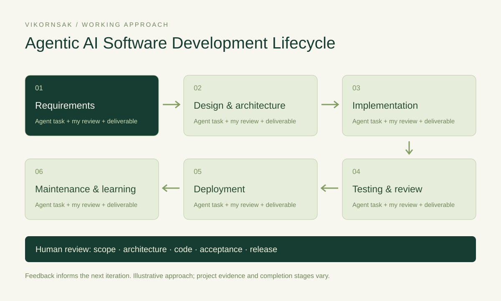

# Agentic AI SDLC — Working Approach

[Explore the interactive SDLC](https://kpdevspace.github.io/vikornsak-portfolio/#agentic-sdlc)

## Requirements

**Agent task:** A requirements agent turns stakeholder notes into user stories, workflow rules, open questions and draft acceptance criteria.

**My decision and review:** I confirm the business problem, scope, user roles and what counts as an acceptable result.

**Expected deliverable:** A reviewed brief, prioritized backlog and acceptance criteria.

**Illustrative example:** For a solar-service journey, ask the agent to separate homeowner and provider needs, map discovery → quotation → installation → care, and flag payment or signing assumptions for confirmation.

- [solas](https://kpdevspace.github.io/vikornsak-portfolio/#projects?project=solas): The documented product brief maps a bilingual homeowner/provider journey and phased MVP scope.
- [ssri](https://kpdevspace.github.io/vikornsak-portfolio/#projects?project=ssri): The reporting blueprint demonstrates requirements and delivery planning; it is a concept, not a running service.

## Design & architecture

**Agent task:** An architecture agent explores module boundaries, data models, API contracts, access rules and trade-offs before implementation.

**My decision and review:** I decide the architecture, ownership boundaries, integration scope and security requirements.

**Expected deliverable:** Architecture decisions, data/API contracts and a task breakdown.

**Illustrative example:** For ERP-to-mobile work, ask the agent to compare app-specific identity needs while keeping master data and business rules authoritative in the shared server.

- [kp-mobile](https://kpdevspace.github.io/vikornsak-portfolio/#projects?project=kp-mobile): The mobile architecture reuses the ERP API and separates staff, customer and partner audiences.
- [gov-ea](https://kpdevspace.github.io/vikornsak-portfolio/#projects?project=gov-ea): The architecture portal prototype connects strategy, capabilities, processes, data and applications.

## Implementation

**Agent task:** A coding agent works on a bounded task, follows repository conventions, proposes a patch and reports its changes and unresolved assumptions.

**My decision and review:** I define the task boundaries, review the diff and verify that the implementation follows the agreed business rules.

**Expected deliverable:** Reviewable code changes with a clear scope and handoff notes.

**Illustrative example:** For an ERP inquiry feature, split the work into API contracts, authorization, data relationships and UI behavior. Review each change against the same acceptance criteria.

- [kp-erp](https://kpdevspace.github.io/vikornsak-portfolio/#projects?project=kp-erp): The modular ERP work links inquiries, sourcing, approvals and quotations through shared business data.
- [careone](https://kpdevspace.github.io/vikornsak-portfolio/#projects?project=careone): Clinic development connects patient workflows with role and cross-clinic consent boundaries.

## Testing & review

**Agent task:** A QA agent drafts boundary and failure cases, runs available checks and compares observed results with acceptance criteria.

**My decision and review:** I review failures, inspect representative user journeys and decide whether the evidence is sufficient to accept the change.

**Expected deliverable:** Test results, defects, reproduction steps and a human acceptance decision.

**Illustrative example:** For document extraction, test missing fields, scan quality and spreadsheet outputs. For clinic access, test both allowed and denied actions with test data.

- [eqa](https://kpdevspace.github.io/vikornsak-portfolio/#projects?project=eqa): Extraction and Excel checks are documented; Windows UI validation remains a separate gate.
- [careone](https://kpdevspace.github.io/vikornsak-portfolio/#projects?project=careone): Development records document role/clinic permission checks; production readiness is not implied.

## Deployment

**Agent task:** A release agent checks build inputs, prepares artifacts and release notes, and helps inspect the deployment workflow and environment requirements.

**My decision and review:** I approve the target environment and release, protect credentials and verify the published result and recovery path.

**Expected deliverable:** A versioned artifact, deployment result and post-release verification.

**Illustrative example:** For this portfolio, build and type-check the static app, deploy through GitHub Actions, then verify the live URL, assets and representative interactions.

- [portfolio](https://kpdevspace.github.io/vikornsak-portfolio/#projects?project=portfolio): This portfolio provides a live example of GitHub Actions → GitHub Pages delivery.
- [ncd-learning](https://kpdevspace.github.io/vikornsak-portfolio/#projects?project=ncd-learning): The learning platform records include an IIS package; packaging is separate from installation in production.

## Maintenance & learning

**Agent task:** A maintenance agent groups reported issues, compares current behavior with expected behavior and proposes targeted fixes, regression checks and documentation updates.

**My decision and review:** I prioritize fixes, assess risk, review changes and feed confirmed lessons back into requirements and architecture.

**Expected deliverable:** A reviewed fix, updated documentation and the next improvement backlog.

**Illustrative example:** For an extraction tool, investigate a missing contact field, add a focused regression case, check exported results and document which platform still needs verification.

- [eqa](https://kpdevspace.github.io/vikornsak-portfolio/#projects?project=eqa): The documented extraction work includes field-handling fixes, job history and reviewable exports.
- [voice-ai](https://kpdevspace.github.io/vikornsak-portfolio/#projects?project=voice-ai): The streaming template demonstrates caching and request-path separation; latency and production operations were not measured.

These are examples of a working approach. Links connect related project scope and evidence, and do not claim every agent role or lifecycle stage is implemented or deployed in each project.
