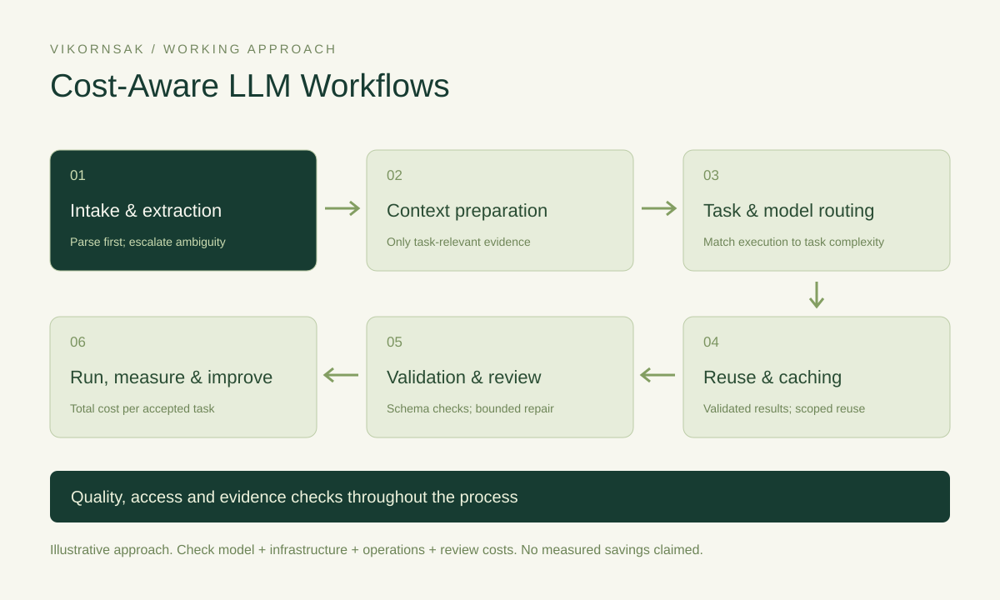

# AI Cost Reduction — Cost-Aware LLM Workflows

[Open the interactive examples](https://kpdevspace.github.io/vikornsak-portfolio/#ai-costs)

## Intake & extraction

**Cost driver:** Send every full PDF to an LLM, including documents with readable text.

**Approach:** Extract text and known fields with a parser and rules first. Use OCR for scans, then ask an LLM only about unresolved fields or ambiguous passages.

**Potential savings mechanism:** Fewer model calls and fewer document pages sent for inference.

**Illustrative example:** In a SAR workflow, parse school contacts and indicators first. Escalate only a missing or ambiguous field to an LLM with its source passage.

**Quality and access gate:** Keep source references, compare against reviewed samples and send unresolved cases for human review.

**Measurement:** LLM escalation rate, input tokens per document, extraction accuracy and review time.

- [eqa](https://kpdevspace.github.io/vikornsak-portfolio/#projects?project=eqa): Documented foundation: PDF text, OCR fallback, rules and exports. Selective LLM escalation is an application of this workflow, not a measured savings claim.
- [data-blueprint](https://kpdevspace.github.io/vikornsak-portfolio/#projects?project=data-blueprint): Design application: define which ingestion tasks need deterministic processing and which need model assistance; the blueprint remains conceptual.

## Context preparation

**Cost driver:** Attach the complete document set and conversation history to every task.

**Approach:** Select task-relevant passages and structured fields, remove duplicate material and set explicit output requirements before the model runs.

**Potential savings mechanism:** Less repeated input and a bounded answer, subject to preserving necessary evidence.

**Illustrative example:** For a research report, provide the selected reporting period, relevant indicators and evidence snippets rather than all historical files.

**Quality and access gate:** Preserve citations and critical exceptions. Test whether omitted context changes the correct answer.

**Measurement:** Input/output tokens per accepted report, evidence coverage and factual error rate.

- [ssri](https://kpdevspace.github.io/vikornsak-portfolio/#projects?project=ssri): Design application: the self-service reporting blueprint is a suitable place to define scoped reporting context; it is not a verified live reporting service.
- [data-chatbot](https://kpdevspace.github.io/vikornsak-portfolio/#projects?project=data-chatbot): Prototype boundary: template queries and mock datasets already bound the data interaction. Semantic retrieval and live database integration are future extensions.

## Task & model routing

**Cost driver:** Use a large model for every request and every intermediate update.

**Approach:** Handle simple tasks with rules, templates or a smaller suitable model. Escalate complex tasks when the quality checks require it.

**Potential savings mechanism:** Reserve more expensive inference for tasks that justify it; routing overhead must also be measured.

**Illustrative example:** For voice interaction, handle partial transcripts with a fast intent path and wait for a final transcript before deeper AI processing.

**Quality and access gate:** Evaluate on representative easy and difficult cases. A cheaper route must meet the same task-specific quality threshold.

**Measurement:** Cost per accepted task, escalation rate, quality by task class and response latency.

- [voice-ai](https://kpdevspace.github.io/vikornsak-portfolio/#projects?project=voice-ai): Documented pattern: separate partial/final transcript paths and fast intent handling. No measured latency or cost reduction is recorded.
- [data-chatbot](https://kpdevspace.github.io/vikornsak-portfolio/#projects?project=data-chatbot): Documented prototype: template-query routing. Multi-model routing is a proposed extension, not an implemented production capability.

## Reuse & caching

**Cost driver:** Recompute the same eligible request every time it is submitted.

**Approach:** Reuse validated outputs only when authorization, input, data version and freshness conditions match. Consider provider prompt caching separately when supported.

**Potential savings mechanism:** Avoid duplicate inference or repeated prefix processing; include cache storage, lookup and invalidation costs.

**Illustrative example:** For a repeated voice request, look up a validated answer within its time-to-live. Refresh it when the underlying data, prompt or permissions change.

**Quality and access gate:** Keep tenant and permission boundaries in the cache key. Never reuse a private answer across users without an explicit access check.

**Measurement:** Eligible cache-hit rate, avoided calls, stale-answer rate and total serving cost.

- [voice-ai](https://kpdevspace.github.io/vikornsak-portfolio/#projects?project=voice-ai): Documented pattern: Redis caching in the final-request path. Any savings still need workload-level measurement.
- [kp-erp](https://kpdevspace.github.io/vikornsak-portfolio/#projects?project=kp-erp): Proposed application: versioned document-summary reuse. The ERP scope is documented; LLM caching is not recorded as implemented.

## Validation & review

**Cost driver:** Regenerate an entire output whenever one field fails validation.

**Approach:** Validate required fields, schemas and business rules in code. Ask the LLM to repair only the affected portion, with bounded retries and human escalation.

**Potential savings mechanism:** Reduce avoidable regeneration and retry loops while retaining quality checks.

**Illustrative example:** If an extracted contact or report field is missing, return the specific issue and supporting passage instead of resending the full document.

**Quality and access gate:** Keep a retry limit and failure state. Clinical, financial and other consequential outputs need the appropriate human review.

**Measurement:** Retry rate, tokens spent on repair, acceptance rate and reviewer workload.

- [eqa](https://kpdevspace.github.io/vikornsak-portfolio/#projects?project=eqa): Documented foundation: field extraction checks and reviewable exports. Targeted LLM repair is an illustrative extension, not a completed integration claim.
- [careone](https://kpdevspace.github.io/vikornsak-portfolio/#projects?project=careone): Proposed application: validate draft administrative summaries within clinic permissions. No autonomous clinical decision-making or LLM savings are claimed.

## Run, measure & improve

**Cost driver:** Compare token prices alone and ignore hosting, retries, reviews and operational overhead.

**Approach:** Measure the whole task, bound loops and concurrency, and batch non-urgent work where supported. Compare local and hosted inference using total cost and accepted outcomes.

**Potential savings mechanism:** Identify the actual cost driver before choosing automation, model size, hosting or scheduling changes.

**Illustrative example:** For a document-processing job, compare candidate approaches on the same reviewed sample, including failures and manual rework. Keep the quality threshold fixed.

**Quality and access gate:** Use a representative baseline, access controls and release gates. Local inference still has compute, maintenance and support costs.

**Measurement:** Total cost per accepted task, end-to-end time, failure rate and human review effort.

- [eqa](https://kpdevspace.github.io/vikornsak-portfolio/#projects?project=eqa): Documented foundation: job history and per-file outputs can support a measurement plan; no formal cost benchmark is provided.
- [portfolio](https://kpdevspace.github.io/vikornsak-portfolio/#projects?project=portfolio): Delivery analogy: this site demonstrates build/deploy and live verification. AI usage metering would be a separate proposed integration.

## Measurement boundary

Total cost per accepted task = (model + infrastructure + operations + review and rework costs) / accepted tasks. Compare a representative workload at the same quality threshold. No savings percentage or benchmark is claimed. Documented patterns, design applications and proposed extensions are labeled in the project links.

## Methods references

- [Microsoft AI cost optimization](https://learn.microsoft.com/en-us/startups/build/ai/ai-cost-optimization)
- [AWS production architecture](https://docs.aws.amazon.com/prescriptive-guidance/latest/gen-ai-lifecycle-operational-excellence/preprod-architecting.html)
